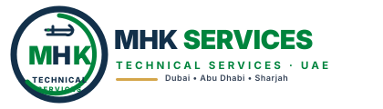

# MHK Technical Services — WordPress Theme, Plugin & Web Portal



A complete, production-ready enterprise solution for **MHK Technical Services UAE**, delivering:
1. **`uae-technical-services/` WordPress Theme**: Reusable, design-focused WordPress theme engineered with a Deep Blue (`#12304A`), UAE Green (`#00843D`), Slate (`#334155`), and Gold (`#D4A64A`) palette.
2. **`uae-technical-services.zip`**: Installable theme ZIP package ready for immediate upload via WordPress admin dashboard.
3. **`mhk-technical-services-theme/`**: Starter business WordPress theme with centralized HD emblem logo.
4. **`mhk-technical-services-theme.zip`**: Upload-ready starter theme package.
5. **React Web Application (`glams/react-app/`)**: Responsive web portal deployed live on Vercel.
6. **Enterprise WordPress Plugin (`glams/`)**: Backend activities manager, REST API, certificate validation, and Elementor integration.

---

## 🚀 Live Deployments & Repository

- **Live Production Portal (Vercel)**: [https://react-app-nu-one-90.vercel.app](https://react-app-nu-one-90.vercel.app)
- **GitHub Repository**: [https://github.com/ahmadkhan32/glams-wordpress-plugin_1.git](https://github.com/ahmadkhan32/glams-wordpress-plugin_1.git)

---

## 🎨 Global Design System

| Element | Value | Description |
| :--- | :--- | :--- |
| **Primary Color** | `#12304A` | Deep Blue for header, footer, hero gradient & headings |
| **Accent Color** | `#00843D` | UAE Green for action buttons, links & verified badges |
| **Secondary Text** | `#334155` | Slate for readable body copy across all pages |
| **Background** | `#F8FAFC` | Clean, crisp modern surface |
| **Premium Accent** | `#D4A64A` | Gold for trust badges, star ratings, borders |
| **Heading Font** | `Poppins`, `Inter` | Professional, bold modern typography |
| **Body Font** | `Inter` | Clean and legible on Retina and mobile displays |
| **Buttons** | `#00843D` | Green background, white text, subtle hover lift |
| **Cards** | `#FFFFFF` | White background, subtle border & soft shadow |
| **Header** | `#12304A` | Deep Blue with white navigation & green Contact Us button |
| **Footer** | `#12304A` | Deep Blue with white headings, slate copy & gold accents |

---

## 📁 1. UAE Technical Services Theme Structure (`uae-technical-services/`)

```
uae-technical-services/
├── style.css                      # Theme metadata & core CSS tokens
├── functions.php                  # Modular loader requiring inc/ files
├── index.php                      # Fallback template
├── front-page.php                 # Homepage integrating all sections
├── page.php                       # Standard static pages
├── single.php                     # Blog post template with author & meta
├── archive.php                    # Archive template for categories/tags
├── 404.php                        # Branded error 404 page
├── header.php                     # Header template calling site-header.php
├── footer.php                     # Footer template calling site-footer.php
├── template-parts/
│   ├── header/
│   │   └── site-header.php        # Header: Deep Blue (#12304A), logo on left, center nav, green CTA
│   ├── footer/
│   │   └── site-footer.php        # Footer: Deep Blue (#12304A), reused logo, 4 columns, copyright
│   └── sections/
│       ├── hero.php               # Hero banner with badge & action buttons
│       ├── services.php           # Core capabilities grid
│       ├── about.php              # Company overview & achievements
│       ├── why-choose-us.php      # 4 core benefits grid
│       ├── process.php            # 4-step workflow (Consultation to Handover)
│       ├── testimonials.php       # Client reviews & gold stars
│       ├── faq.php                # Interactive accordion FAQs
│       ├── contact-cta.php        # Conversion call-to-action banner
│       └── contact-form.php       # 2-column contact grid with inquiry form
├── page-templates/
│   ├── page-about.php             # Template Name: About Us
│   ├── page-services.php          # Template Name: Services Catalog
│   ├── page-contact.php           # Template Name: Contact Us
│   ├── page-visa-assistance.php   # Template Name: Visa Assistance
│   ├── page-document-clearing.php # Template Name: Document Clearing
│   ├── page-business-setup.php    # Template Name: Business Setup
│   ├── page-privacy-policy.php    # Template Name: Privacy Policy
│   └── page-terms.php             # Template Name: Terms & Conditions
├── assets/
│   ├── images/
│   │   ├── logo.svg               # Primary company logo
│   │   ├── logo-white.svg         # White logo for dark background
│   │   ├── favicon.png            # Browser icon
│   │   └── mhk-technical-services-logo.png # HD emblem logo (1394x1128 px)
│   ├── css/
│   │   ├── main.css               # Global styles, buttons, badges, cards
│   │   ├── header.css             # Navigation & header layout
│   │   ├── footer.css             # Footer layout & branding
│   │   ├── home.css               # Homepage sections
│   │   ├── pages.css              # Inner pages
│   │   └── responsive.css         # Mobile & tablet layouts
│   └── js/
│       ├── navigation.js          # Smooth scroll
│       ├── mobile-menu.js         # Mobile hamburger drawer
│       ├── faq.js                 # Accordion toggle
│       └── contact-form.js        # Form submission handling
└── inc/
    ├── theme-setup.php            # Menus, theme support, custom logo
    ├── enqueue-assets.php         # Modular CSS/JS enqueuing
    ├── customizer.php             # Contact info customizer settings
    ├── template-functions.php     # Centralized logo function (uae_the_theme_logo)
    └── security.php               # SVG uploads & sanitation
```

---

## 2. Logo Placement — Header & Footer

### Header Design
- **Position**: Logo on the left side of the header navigation bar against Deep Blue (`#12304A`).
- **Center**: Navigation menu with white links and subtle hover indicators.
- **Right**: UAE Green button (`#00843D`) for "Contact Us".
- **Mobile**: Responsive hamburger toggle that reveals a smooth mobile navigation drawer.

### Footer Design
- **Position**: Reuses the company logo at the top of the footer branding column.
- **Content**: Company description, ISO standards badge, quick navigation links, services list, full contact details (address, phone, email, hours), legal links, and copyright notice.

### Logo Implementation Rule
Registered WordPress Custom Logo support and implemented `uae_the_theme_logo( $location, $variant )` in [`inc/template-functions.php`](uae-technical-services/inc/template-functions.php).
- Supports Customizer uploads via `the_custom_logo()`.
- Falls back to `logo-white.svg` or HD PNG `mhk-technical-services-logo.png` on dark backgrounds.
- Avoids duplicate, inconsistent logo copies across templates.

---

## 3. How to Install the Theme in WordPress

1. Download [`uae-technical-services.zip`](uae-technical-services.zip) from the repository root.
2. Log in to your WordPress Admin dashboard (`yourdomain.com/wp-admin`).
3. Open **Appearance → Themes → Add New Theme → Upload Theme**.
4. Select `uae-technical-services.zip`.
5. Click **Install Now**, then click **Activate**.
6. Open **Appearance → Menus** and assign:
   - **Primary Navigation** to your main header menu.
   - **Footer Navigation** to your footer links menu.
7. Open **Appearance → Customize → MHK Contact Information** to set phone, email, and office address.

---

## 4. React App & Vercel Deployment

```bash
cd glams/react-app
npm install
npm run build
npx vercel deploy --prod
```
The React app is configured with matching Deep Blue `#12304A`, UAE Green `#00843D`, Gold `#D4A64A`, and Slate `#334155` styling, and is live at **https://react-app-nu-one-90.vercel.app**.
